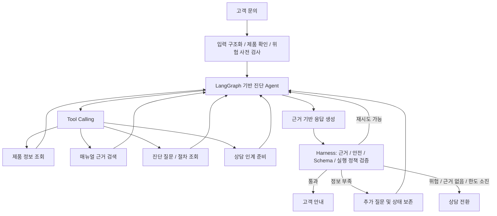

# WaterBridge 2.0 — AI Engineer 포트폴리오 고도화 계획서

> 문서 상태: 초안 v0.1 · 2026-11-01  
> 대상 저장소: `SKNETWORKS-FAMILY-AICAMP/SKN29-FINAL-4TEAM`  
> 작업 브랜치: **`seunghyuk`**  
> 작업 디렉터리: **`portfolio_upgrade/`**  
> 개발 원칙: 일정은 고정하지 않고, 구현·실험 결과를 보며 범위와 기술 선택을 조정한다.

## 1. 프로젝트 목표

### 한 문장 정의

**공식 매뉴얼을 근거로 고객의 증상을 단계적으로 진단하고, Agent의 도구 실행과 생성 응답을 검증하여 신뢰할 수 있는 조치 안내 또는 상담 인계를 제공하는 AI 시스템을 만든다.**

기존 WaterBridge는 문제 도메인과 출발점이다. 기존 PM 역할과 과거 구현 범위에 프로젝트 방향을 한정하지 않고, 이번 고도화에서 **직접 구현하고 검증한 AI 엔지니어링 역량**을 새로 축적한다.

최종 포트폴리오에서 전달할 핵심 메시지는 다음과 같다.

> "저는 LLM을 서비스에 연결하는 데 그치지 않고, 필요한 근거를 정확히 찾고, 상황에 맞게 도구를 사용하고, 실패하더라도 안전하게 동작하도록 시스템을 설계·구현·평가할 수 있습니다."

### 목표 사용자 경험

가상 예시: 고객이 "온수가 안 나오고 버튼이 깜빡여요"라고 문의한다.

1. 제품 모델과 증상을 구조화하고, 위험 신호를 먼저 확인한다.
2. 해당 제품의 공식 매뉴얼에서 관련 증상·조치·진단 조건을 검색한다.
3. 정보가 부족하다면 확인해야 할 질문을 선택한다.
4. 고객 답변을 반영해 진단을 계속한다.
5. 매뉴얼 근거로 뒷받침되는 허용된 조치만 안내한다.
6. 위험·근거 부족·도구 실패 등의 경우 안전하게 상담으로 전환한다.

위 사례는 **구현하려는 흐름을 설명하는 예시**이며 실제 조치 문구·분기는 승인된 안전 규칙과 매뉴얼에 근거해 정한다.

## 2. 개발 원칙과 범위

- 모든 핵심 개선은 **문제 재현 → 개선 가설 → 구현 → 동일 조건 비교 → 결과 및 한계**의 순서로 기록한다.
- **기술 이름을 늘리는 것**보다 사용 이유와 개선 효과의 설명 가능성을 우선한다.
- 기존 팀 프로젝트의 코드·성과와 개인 고도화의 변경 내역을 구분한다. 본인이 직접 구현한 부분은 커밋·테스트로 추적한다.
- 과거 포트폴리오의 성능 수치를 검증 없이 새 프로젝트의 기준선으로 옮기지 않는다.
- 실제 고객 서비스의 운영 성과를 주장하지 않는다. 공식 문서·검수 데이터·합성 시나리오 기반 검증으로 표현한다.
- 안전·권한·도구 실행 제약은 프롬프트가 아닌 **프로그램의 결정적 검사**로 강제한다.
- 초기 개발 범위는 작은 제품·매뉴얼 집합으로 제한하고, 동작과 평가가 안정된 뒤 확장한다.
- 기술 선택과 단계 순서는 유연하게 바꿀 수 있다. 정해진 마감일이나 특정 점수 달성 자체를 목표로 삼지 않는다.

## 3. 목표 시스템 아키텍처



**Reliability Harness는 마지막 응답 검사기만 의미하지 않는다.** 실행 전 위험·권한 검사, Tool 실행 예산·재시도 제어, 중간 상태·실패 관리, 생성 후 근거·안전 검증까지 전체 실행을 감싸는 계층으로 설계한다.

## 4. 주요 기술 후보

| 영역 | 우선 검토 기술 | 채택 기준 |
| --- | --- | --- |
| 언어·API·테스트 | Python, FastAPI, pytest | 재현성과 독립 실행이 쉬움 |
| PDF 문서화 | Docling, 구조 기반 청킹 | 표·도식·절차 구조 손실이 실제 문제일 때 |
| 임베딩 | BGE-M3 | 공통 Baseline과 비교 실험 |
| 저장소 | 기존 pgvector 재사용 또는 Qdrant | 모델 필터, 실험 재현성, 운영 단순성 |
| 고급 검색 | BM25 + Dense, RRF, Cross-Encoder Reranker | 검색 개선 폭과 지연시간의 균형 |
| Agent | LangGraph, Tool Calling, Pydantic | 상태·도구 입력·분기 제어 |
| MCP | Manual Knowledge MCP Server 한 개(선택) | 다른 클라이언트에서 실제 재사용할 이유가 있을 때 |
| 실행 제어 | Harness, Guardrails, HITL | 실패·위험·권한을 일관되게 통제 |
| 평가·관측 | pytest, Langfuse 또는 OpenTelemetry, Ragas(보조) | 결과 재현·Trace·회귀 추적 |
| 모델 학습(선택) | PyTorch, Sentence Transformers | Hard Negative 데이터 확보, 개선 검증 가능 시 |
| 멀티모달(선택) | Visual Retrieval / VLM | 시각 자료가 검색 실패를 유발할 때 |

기본 원칙은 **한 영역에 핵심 기술 하나**다. Vector DB나 Trace 서비스를 여러 개 도입하는 자체는 성과로 간주하지 않는다.

## 5. 고도화 단계별 계획

다음 Phase는 권장 진행 순서다. 서로 일부 겹쳐 진행하거나, 실험 결과에 따라 돌아가 보완해도 된다.

### Phase 0 — 평가 기반과 기본 RAG 마련

**문제:** 개선 전의 실패를 재현할 수 없다면 개선을 증명하기 어렵다.

**할 일**
- 사용할 공식 매뉴얼·제품 범위와 공개 가능한 데이터 범위를 확인한다.
- 정상 증상 / 구어체 / 복합 증상 / 교차 제품 / 매뉴얼 근거 없음 / 위험 상황의 평가 사례를 모은다.
- 질문별로 제품, 정답 Evidence, 기대 조치·질문·전환 경로를 기록하고 사람이 검수한다.
- 개발·튜닝용과 최종 평가용 데이터를 분리한다. 동일 근거의 말바꾸기 문항이 양쪽에 겹치는 누수를 점검한다.
- **기본 Dense RAG**를 구현 또는 재현해 Baseline을 측정한다.
- 문서/데이터/모델/프롬프트/커밋 버전과 환경을 기록하는 최소 평가 Runner를 만든다.

**증거:** Baseline 리포트, 검수된 평가셋, 대표 실패 사례, 실행 명령.

**완료의 예:** 같은 명령·조건으로 주요 성공/실패를 재현할 수 있고, 무엇이 잘못되는지 유형별로 설명할 수 있다.

### Phase 1 — Advanced RAG: 필요한 근거를 정확하게 검색

**문제:** 의미적으로 비슷하지만 해당 제품·증상에 부적합한 문서가 검색될 수 있다.

**할 일**
- 단순 청킹과 표·섹션·진단 절차를 유지하는 청킹을 비교한다.
- 정확한 제품 모델 필터와 Evidence 출처·페이지를 연결한다.
- Dense → Hybrid(BM25 + Dense + RRF) → Reranker를 차례로 비교한다.
- 검색 실패를 검색 누락, 순위 문제, 제품 범위 오류, 무근거 오탐으로 분류한다.
- 개선 이득이 작거나 지연이 과도한 구성요소는 채택하지 않는다.

**기술:** BGE-M3, BM25, RRF, Cross-Encoder, Docling(필요 시), pgvector/Qdrant 중 택일.

**평가:** Hit@1, Hit@5, MRR, nDCG@5, Wrong Product Hit, No-Evidence 탐지, 검색 지연시간.

**증거:** 검색 파이프라인, 동일 조건 Ablation, 실패가 개선된 실제 질문 예시.

**완료의 예:** 선택한 검색 방식을 정량 지표와 지연시간 측면에서 설명할 수 있다.

### Phase 2 — Tool-Using Diagnostic Agent: 단계적 문답

**문제:** 초기 질문만으로 충분한 진단 정보를 확보하지 못할 수 있다.

**할 일**
- LangGraph State에 제품, 증상, 이미 확인한 사실, 대화 이력, 근거, 진단 상태를 정의한다.
- 우선 도구를 네 종류로 단순하게 설계한다.
  - `get_product_info`: 모델 및 지원 기능 조회
  - `search_manual`: 공식 근거 검색
  - `get_diagnostic_steps`: 허용된 진단 질문·절차 조회
  - `prepare_handoff`: 상담 인계용 진단 이력 구성
- Agent가 상황에 따라 Tool을 선택하되, **Tool 실행 자체는 서버에서 입력·권한 검사**를 거치도록 한다.
- 필요한 정보를 추가로 물어보고 체크포인트에서 진단을 재개한다.
- 반복 질문, 무한 루프, 근거 없는 추측을 방지하는 중단·전환 조건을 마련한다.
- MCP는 기본 Tool Calling이 동작한 뒤 **실제 외부 재사용 가치가 있을 때만** 별도 구현한다.

**기술:** LangGraph, Tool Calling, Pydantic, Checkpointer, MCP(선택).

**평가:** 진단 성공률, 추가 질문 적절성, 평균 진단 턴, Tool Selection Accuracy, 불필요한 Tool 호출 수.

**증거:** 상태도, Tool Schema, 대표 문답과 호출 Trace, 단발성 RAG 비교.

**완료의 예:** 복합 문의에서 무작정 답하지 않고 질문·검색·상담 전환 중 적절한 경로를 결정한다.

### Phase 3 — Reliability Harness & Safety: 실패를 통제

**문제:** Agent가 선택한 도구와 생성된 답변을 그대로 신뢰할 수 없다.

**할 일**
- Tool 호출 전 Schema, 권한, 제품 범위, 위험 신호를 검사한다.
- Timeout, 호출 한도, Retry Budget, 오류별 Retry / Fallback / Escalation 정책을 구현한다.
- 조회 권한과 외부 상태 변경 권한을 구분한다. 상담 접수 등 부작용 있는 작업은 승인과 서버 측 권한 검사를 요구한다.
- 검색 출처, Evidence ID, 제품 모델, 허용 조치와 생성 안내의 정합성을 확인한다.
- 위험 응답을 차단하면서 **정상 안전 안내의 오차단**도 측정하고 개선한다.
- 무근거·위험·재시도 소진 등에는 HITL 또는 상담 전환 경로를 마련한다.
- 요청 ID, Tool 호출, 검증 결정, 오류 사유와 지연시간을 추적한다.

**기술:** Harness, Guardrails, Grounding Verification, Pydantic, OpenTelemetry/Langfuse, HITL.

**평가:** Unsafe Pass Rate, False Block Rate, 권한 위반 실행 차단율, 오류 복구율, 호출 비용, P95 지연시간.

**증거:** Harness 결정표, 오류 주입 테스트, 정상·위험 회귀 테스트, 실행 Trace.

**완료의 예:** 잘못된 Tool 응답, 타임아웃, 무근거 또는 위험 안내에서도 실행 결과를 예측하고 재현할 수 있다.

### Phase 4 — E2E 평가와 포트폴리오 구성

**문제:** 각 부품의 성능 향상이 전체 진단 품질 개선을 뜻하지는 않는다.

**할 일**
- 동일 평가 환경에서 다음 구성을 비교한다.
  - A: 기본 Dense RAG
  - B: Advanced RAG
  - C: Advanced RAG + Tool-Using Agent
  - D: Advanced RAG + Agent + Harness / Safety
- 필요 시 개별 구성요소를 끄거나 교체하는 **표적 Ablation**으로 기여도를 분리한다.
- 위험 안전장치를 해제하는 비교는 **격리된 합성 테스트**에서만 수행한다.
- 성능 개선과 함께 비용·지연시간·잘못된 진단·불필요한 질문의 변화도 확인한다.
- 성과가 없는 시도와 남은 한계도 기록한다.
- 평가 리포트, 그래프, 대표 Trace 및 코드 링크를 기반으로 6페이지 포트폴리오를 제작한다.

**증거:** 재현 가능한 E2E 리포트, 성능 비교 그래프, 평가셋 요약, 주요 아키텍처 결정 기록.

**완료의 예:** 면접에서 "왜 이 기술을 썼고, 이전보다 무엇이 나아졌나요?"에 대해 수치·코드·실패 사례를 함께 제시할 수 있다.

### Optional — 필요성이 확인되면 더 깊게

- **Reranker Fine-tuning:** Hard Negative를 충분히 구축하고 과적합을 통제할 수 있을 때 PyTorch/Sentence Transformers로 학습한다. 학습에 사용하지 않은 평가셋으로 비교한다.
- **Visual / Multimodal Retrieval:** 매뉴얼 이미지·표·도식이 검색 실패를 유발한다는 증거가 있을 때 실험한다.
- **MCP Server 확장:** 도구의 독립 배포·다중 클라이언트 재사용이 실제 요구가 될 때 확장한다.
- **Multi-Agent 분리:** 하나의 Stateful Agent로 해결되지 않는 독립적인 책임·성과 차이가 확인될 때만 고려한다.

Optional 요소는 생략해도 핵심 포트폴리오가 완성되도록 한다.

## 6. 평가 체계와 실험 관리

| 대상 | 확인할 질문 | 대표 지표 |
| --- | --- | --- |
| Retrieval | 올바른 제품·증상 근거를 찾는가? | Hit@K, MRR, nDCG, 잘못된 제품 근거률 |
| Agent | 필요한 질문과 도구를 올바르게 선택하는가? | 진단 성공률, 추가 질문 적절성, Tool 정확도 |
| Grounding | 각 안내 조치가 승인 근거와 연결되는가? | 조치별 Grounding 충족률, 근거 없는 조치율 |
| Safety | 위험을 차단하고 정상 안내는 보존하는가? | Unsafe Pass Rate, False Block Rate |
| Harness | 장애·권한 오류에서 안전하게 실패하는가? | 복구율, 잘못된 Tool 실행 차단율, Retry 횟수 |
| Efficiency | 개선 폭에 비해 비용이 적절한가? | P50/P95 지연, 토큰·Tool 호출 비용 |

- 평가 질문 수는 미리 고정하지 않는다. 소수 검수 사례로 시작해 재현성과 다양성을 먼저 확보한다.
- LLM Judge와 Ragas는 **보조 지표**다. 사람의 Ground Truth 검수와 코드 기반 회귀 테스트를 함께 사용한다.
- 모든 실험은 코드 Commit, 평가셋/문서 버전, 임베딩 및 LLM 모델, 프롬프트, 환경, 실행 명령, 결과를 남긴다.
- 평가셋을 수정했다면 버전을 바꾸고 과거 결과와 무심코 직접 비교하지 않는다.

## 7. 최종 포트폴리오 6페이지

각 페이지가 **문제 정의 → 해결 과정 → 결과**를 담고, 앞 페이지의 한계가 다음 페이지의 개발 이유로 이어지게 한다.

| 페이지 | 핵심 주장 | 보여줄 기술적 근거 |
| --- | --- | --- |
| **01. 문제 정의 및 아키텍처** | 단발성 RAG로는 안전한 복합 증상 진단이 어렵다. | 대표 실패 사례, 프로젝트 목표, 전체 구조, 본인 기여 범위 |
| **02. Advanced RAG** | 매뉴얼을 더 적절한 근거 단위로 검색한다. | 청킹/Hybrid/Reranker 비교, 검색 품질과 비용 |
| **03. Diagnostic Agent** | 정보가 부족하면 추측 대신 추가 질문과 Tool을 선택한다. | LangGraph 상태도, Tool Calling/MCP(선택), 문답 Trace |
| **04. Reliability Harness** | Agent 실패·오작동을 서버의 정책으로 통제한다. | Schema/권한/Retry/Timeout/HITL, 오류 주입 실험 |
| **05. Safety & Grounding** | 위험 안내는 막고 정상 안내는 보존한다. | 근거·조치 검증, 위험/정상 사례 회귀 테스트 |
| **06. E2E Evaluation** | 개선은 비교 가능한 실험 결과로 입증한다. | Ablation, 종합 성능/비용, 한계와 재현 링크 |

권장 페이지 내부 구성: **문제 20% / 기술적 구현 50% / 결과 30%**. 모든 페이지에서 "그래서 본인이 무엇을 바꾸었는가"가 분명히 드러나도록 한다.

## 8. 저장소 구조 및 협업/운영 규칙

**모든 초기 작업은 `seunghyuk` 브랜치의 `portfolio_upgrade/` 아래에서 진행한다.** 팀 공용 경로는 우선 수정하지 않는다. 기존 구현 재사용이 필요하면 작은 Adapter로 연결하거나 개인 전용 모듈로 독립 구현한다.

권장 구조는 아래와 같다. **지금 당장 빈 폴더를 전부 만들 필요는 없다.**

```text
portfolio_upgrade/
├── README.md
├── UPGRADE_PLAN.md
├── src/
│   └── waterbridge_upgrade/
│       ├── ingestion/
│       ├── retrieval/
│       ├── agents/
│       ├── tools/
│       ├── harness/
│       ├── safety/
│       └── api/
├── configs/
├── evals/
│   ├── datasets/
│   ├── runners/
│   └── reports/
├── tests/
├── scripts/
└── docs/
    ├── decisions/
    └── portfolio/
```

- 새 기능과 실험 결과는 가능하면 작은 단위로 커밋한다.
- 재현 가능한 공개 Fixture와 요약 리포트는 저장하고, API 키·고객정보·사용 조건에 위배되는 원문은 저장하지 않는다.
- 중요한 기술 선택에는 간단한 결정 기록을 남긴다: 문제, 대안, 비교 실험, 선택, 비용과 한계.
- 과거 팀 성과와 새 개인 고도화의 결과/기여도를 혼동하지 않는다.

## 9. 우선순위 — 느슨하게 운영

| 구분 | 범위 | 이유 |
| --- | --- | --- |
| **P0 — 핵심** | 평가 데이터/기준선, 고급 검색 비교, Tool-Using Agent, 실행·안전 Harness, E2E 평가 | 이것만으로 프로젝트의 핵심 스토리를 완성할 수 있음 |
| **P1 — 효과 있을 때** | PDF 구조 분석, 본격적인 Reranking, Langfuse 대시보드, 작은 MCP Server | 실험·재사용 가치가 확인되면 추가 |
| **P2 — 심화 선택** | Fine-tuning, Visual Retrieval, Multi-Agent 확장, GraphRAG | 구현 부담이 크고 효과를 입증하지 못하면 오히려 산만해짐 |

## 10. 바로 시작할 최소 작업

1. 공식 매뉴얼과 제품 모델 범위를 정해 평가할 대상을 좁힌다.
2. 일반/복합/위험/무근거 실패 사례를 검수하여 Baseline 평가셋 초안을 만든다.
3. 기존 또는 새 Dense RAG를 동일 조건에서 실행해 검색 결과를 기록한다.
4. 개선 기능을 **한 가지씩** 도입하면서 실험 리포트를 남긴다.
5. 검색이 재현되면 작은 Tool-Using Agent의 정상 실행 경로를 먼저 만들고, Harness로 실패 경로를 강화한다.

**최종 원칙:** "많은 기술을 사용했다"가 아니라 **"어려운 문제를 정의하고, 직접 기술을 선택·구현하며, 개선과 한계를 재현 가능한 근거로 설명할 수 있다"**를 증명한다.
